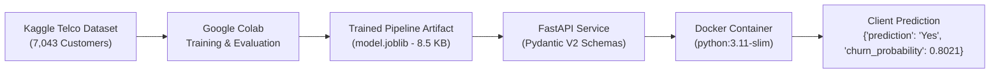
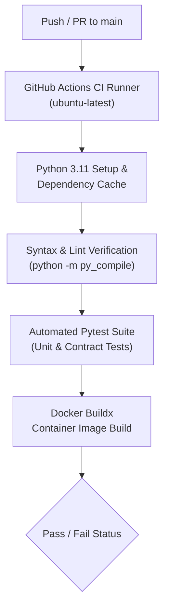

# Telco Customer Churn Prediction — End-to-End ML + MLOps Pipeline

[](https://github.com/aryanjha14092005/telco-churn-mlops/actions/workflows/ci.yml)
[](https://fastapi.tiangolo.com)
[](https://www.docker.com)
[](https://scikit-learn.org)
[](https://www.python.org)

Production-grade, end-to-end Machine Learning and MLOps project for predicting customer churn using the Kaggle Telco Customer Churn dataset.

> **Architecture Division of Responsibility:**
> - **Model Training & Experimentation:** Completed in **Google Colab** on the Kaggle Telco Customer Churn dataset, serialized and saved as `model.joblib`.
> - **Inference Service, Containerization & CI/CD:** Developed and maintained in this repository using **FastAPI**, **Docker**, and **GitHub Actions**.

---

## 1. Project Overview & Business Problem

Customer churn represents a critical metric for telecommunications service providers. Acquiring new customers typically costs significantly more than retaining existing ones. Predicting high-risk accounts allows proactive customer retention campaigns, targeted discounts, and service optimizations.

This project packages a trained classification pipeline into a production-ready REST API with strict input schema validation, automated integration and unit testing, multi-stage Docker containerization, and automated GitHub Actions CI.

- **Source Dataset:** [Kaggle Telco Customer Churn (BlastChar)](https://www.kaggle.com/datasets/blastchar/telco-customer-churn)
- **Target Label:** `Churn` (`Yes` / `No`)
- **Primary Objective:** Deliver real-time, low-latency churn risk probabilities and classification decisions via REST endpoints.

---

## 2. Architecture & Pipeline Workflows

### End-to-End System Architecture



### GitHub Actions CI/CD Pipeline



---

## 3. Model & Preprocessing Pipeline

The model artifact is an end-to-end `sklearn.pipeline.Pipeline` trained using **scikit-learn 1.6.1** consisting of two main stages:

### Step 1: `preprocessor` (`ColumnTransformer`)
1. **Numeric Pipeline:**
   - Features: `SeniorCitizen`, `tenure`, `MonthlyCharges`, `TotalCharges`
   - Preprocessing: `SimpleImputer(strategy='median')` followed by `StandardScaler()`
2. **Categorical Pipeline:**
   - Features: `gender`, `Partner`, `Dependents`, `PhoneService`, `MultipleLines`, `InternetService`, `OnlineSecurity`, `OnlineBackup`, `DeviceProtection`, `TechSupport`, `StreamingTV`, `StreamingMovies`, `Contract`, `PaperlessBilling`, `PaymentMethod`
   - Preprocessing: `SimpleImputer(strategy='most_frequent')` followed by `OneHotEncoder(handle_unknown='ignore')`

### Step 2: `classifier` (`LogisticRegression`)
- Configuration: `class_weight='balanced'`, `max_iter=2000`, `random_state=42`
- Classes: `[0, 1]` mapped to `{"0": "No", "1": "Yes"}`
- Probability Estimation: Supported via `predict_proba()`.
- Feature Schema: Exactly 19 features required in designated order. `customerID` was excluded during training as it is a non-predictive entity identifier.

---

## 4. Repository Structure

```
telco-churn/
├── model/
│   ├── model.joblib              # Serialized trained scikit-learn pipeline (8.5 KB)
│   └── metadata.json             # Model metadata, feature schema, and version info
├── app/
│   ├── __init__.py               # App package initialization
│   ├── main.py                   # FastAPI application with lifespan management
│   ├── schemas.py                # Pydantic v2 schemas and validation models
│   └── model_loader.py           # Model artifact loader, schema enforcer, and inference logic
├── tests/
│   ├── __init__.py
│   ├── test_api.py               # API endpoint tests (root, health, validation, contract)
│   └── test_model.py             # Model inference, schema, probability, and error handling tests
├── notebooks/
│   └── model_training.ipynb      # Training notebook documentation
├── .github/
│   └── workflows/
│       └── ci.yml                # GitHub Actions automated CI workflow
├── Dockerfile                    # Multi-stage production container definition
├── .dockerignore                 # Excluded container context patterns
├── .gitignore                    # Git tracking exclusions
├── pytest.ini                    # Pytest configuration
├── requirements.txt              # Pinned application dependencies
└── README.md                     # Comprehensive project documentation
```

---

## 5. Local Setup & Execution

### Prerequisites
- Python 3.11
- Git

### Installation

1. **Clone the repository:**
   ```bash
   git clone https://github.com/aryanjha14092005/telco-churn-mlops.git
   cd telco-churn-mlops
   ```

2. **Create and activate a virtual environment:**
   ```bash
   python3.11 -m venv .venv
   source .venv/bin/activate
   ```

3. **Install dependencies:**
   ```bash
   pip install --upgrade pip
   pip install -r requirements.txt
   ```

4. **Launch the FastAPI application locally:**
   ```bash
   uvicorn app.main:app --host 0.0.0.0 --port 8000 --reload
   ```

5. **Access the service:**
   - Root Info: [http://localhost:8000/](http://localhost:8000/)
   - Health Check: [http://localhost:8000/health](http://localhost:8000/health)
   - Interactive Swagger Docs: [http://localhost:8000/docs](http://localhost:8000/docs)
   - ReDoc: [http://localhost:8000/redoc](http://localhost:8000/redoc)

---

## 6. Docker Containerization

### Build the Docker Image
```bash
docker build -t telco-churn-api:latest .
```

### Run the Container
```bash
docker run --rm -p 8000:8000 --name telco-churn-container telco-churn-api:latest
```

The container runs as a non-privileged `appuser` and includes a built-in health check querying `http://localhost:8000/health`.

---

## 7. API Endpoints & Sample Requests

### `GET /`
Returns general API information and discovery endpoints.
```json
{
  "title": "Telco Customer Churn Prediction API",
  "description": "ML service providing real-time customer churn predictions.",
  "version": "1.0.0",
  "status": "running",
  "docs_url": "/docs",
  "health_url": "/health",
  "predict_url": "/predict"
}
```

### `GET /health`
Returns service and model status.
```json
{
  "status": "healthy",
  "model_loaded": true,
  "model_version": "1.0.0",
  "scikit_learn_version": "1.6.1"
}
```

### `POST /predict`

#### Sample 1: High Churn Risk Customer (Month-to-month, Fiber Optic, 1 Month Tenure)
**Request:**
```bash
curl -X POST http://localhost:8000/predict \
  -H "Content-Type: application/json" \
  -d '{
    "gender": "Female",
    "SeniorCitizen": 0,
    "Partner": "Yes",
    "Dependents": "No",
    "tenure": 1,
    "PhoneService": "No",
    "MultipleLines": "No phone service",
    "InternetService": "DSL",
    "OnlineSecurity": "No",
    "OnlineBackup": "Yes",
    "DeviceProtection": "No",
    "TechSupport": "No",
    "StreamingTV": "No",
    "StreamingMovies": "No",
    "Contract": "Month-to-month",
    "PaperlessBilling": "Yes",
    "PaymentMethod": "Electronic check",
    "MonthlyCharges": 29.85,
    "TotalCharges": 29.85,
    "customerID": "7590-VHVEG"
  }'
```

**Response (`200 OK`):**
```json
{
  "prediction": "Yes",
  "churn_probability": 0.8021,
  "model_version": "1.0.0"
}
```

#### Sample 2: Low Churn Risk Customer (Two-Year Contract, 60 Months Tenure)
**Request:**
```bash
curl -X POST http://localhost:8000/predict \
  -H "Content-Type: application/json" \
  -d '{
    "gender": "Male",
    "SeniorCitizen": 0,
    "Partner": "Yes",
    "Dependents": "Yes",
    "tenure": 60,
    "PhoneService": "Yes",
    "MultipleLines": "No",
    "InternetService": "No",
    "OnlineSecurity": "No internet service",
    "OnlineBackup": "No internet service",
    "DeviceProtection": "No internet service",
    "TechSupport": "No internet service",
    "StreamingTV": "No internet service",
    "StreamingMovies": "No internet service",
    "Contract": "Two year",
    "PaperlessBilling": "No",
    "PaymentMethod": "Mailed check",
    "MonthlyCharges": 20.0,
    "TotalCharges": 1200.0
  }'
```

**Response (`200 OK`):**
```json
{
  "prediction": "No",
  "churn_probability": 0.0103,
  "model_version": "1.0.0"
}
```

---

## 8. Automated Testing

The automated test suite in `tests/` covers unit tests for the model artifact, feature order preservation, missing field validation, probability range checks, and API contract integration tests:

```bash
pytest -v
```

**Test Coverage Summary:**
- `test_root_endpoint`: Verifies HTTP 200 and endpoint schema.
- `test_health_endpoint`: Verifies healthy state and model availability.
- `test_predict_endpoint_valid`: Verifies inference response schema and probability.
- `test_predict_endpoint_string_total_charges`: Validates coercion of string charges.
- `test_predict_endpoint_missing_field`: Validates 422 error on missing attributes.
- `test_predict_endpoint_invalid_categorical`: Validates 422 error on unrecognized categories.
- `test_predict_endpoint_negative_tenure`: Validates 422 on boundary constraint violations.
- `test_predict_endpoint_unexpected_field`: Validates 422 on unauthorized extra keys.
- `test_model_unavailable_returns_503`: Validates graceful degradation when model is absent.
- `test_model_artifact_loaded`: Confirms artifact deserialization.
- `test_model_feature_schema`: Validates 19 features in exact order.
- `test_predict_churn_high_risk`: Confirms high churn probability (> 0.5) for high-risk profiles.
- `test_predict_churn_loyal_customer`: Confirms low churn probability (< 0.5) for loyal accounts.
- `test_predict_missing_feature`: Confirms `ValueError` on incomplete feature payloads.
- `test_metadata_contents`: Confirms schema consistency with `metadata.json`.

---

## 9. GitHub Actions CI Pipeline

The CI workflow `.github/workflows/ci.yml` triggers on every push and pull request to `main`:
1. Checks out repository code.
2. Sets up Python 3.11 with pip caching.
3. Installs requirements from `requirements.txt`.
4. Runs syntax and compilation checks (`python -m py_compile`).
5. Executes automated `pytest -v` tests.
6. Builds the Docker container image via `docker/setup-buildx-action` to ensure image integrity.

Since `model/model.joblib` is lightweight (8.5 KB), it is committed directly to the repository, enabling 100% reproducible and offline CI runs without external storage dependencies or Kaggle credentials.

---

## 10. Troubleshooting & Known Limitations

### scikit-learn Version Mismatch Resolution
- **Symptom:** `AttributeError: Can't get attribute '_RemainderColsList' on 'sklearn.compose._column_transformer'`
- **Diagnosis:** The artifact was trained in Google Colab using `scikit-learn==1.6.1`. Attempting to load this artifact on newer scikit-learn releases (such as 1.9+) causes serialization errors due to internal refactoring of `ColumnTransformer`.
- **Solution:** `requirements.txt` strictly pins `scikit-learn==1.6.1` to maintain full binary and serialization parity with the training environment.

### customerID Handling
- `customerID` is accepted in the request payload for convenience, but is automatically stripped prior to pipeline ingestion so as not to disrupt feature dimensions.
